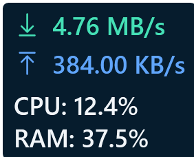
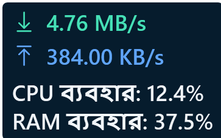
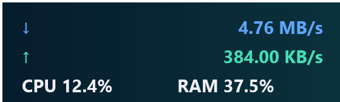
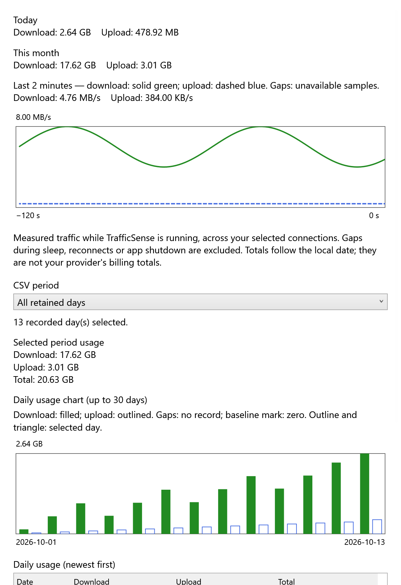

# TrafficSense

**Network speed, system health and usage history for Windows — in English and বাংলা.**

[Download](https://github.com/almuzahidseyam/TrafficSense/releases/latest) · [What's new](CHANGELOG.md) · [বাংলা নির্দেশনা](docs/GETTING_STARTED_BN.md) · [Report a problem](https://github.com/almuzahidseyam/TrafficSense/issues/new/choose)

[](https://github.com/almuzahidseyam/TrafficSense/actions/workflows/ci.yml)

<table><tr><td></td><td></td></tr></table>

*Actual app controls rendered with illustrative traffic and system values. These images are demos, not performance benchmarks.*

## What it does

- **Live network rates:** independent background sampling, actual elapsed time, 250 ms / 500 ms / 1 s / 2 s intervals, bytes/s or bits/s, Auto or manual adapter selection. Reconnects and sleep/resume establish a fresh baseline instead of generating a spike.
- **Widget and taskbar display:** draggable always-on-top widget, lock/reset position, monitor recovery, top/bottom edge panel, tray show/hide and single-instance activation. Experimental embedding uses verified vacant taskbar space with an edge-panel fallback.
- **System information:** optional CPU, physical RAM, reported CPU frequency, busiest GPU engine, disk activity/read/write and connection details. Disabled optional metrics stop polling. Missing counters show unavailable.
- **Usage history:** today/month totals, up to 400 retained days, selected date/month totals, daily table and chart, hover details, click-to-select/highlight, exact-byte CSV export and selected-day copying as text or CSV. Optional daily/monthly GiB alerts notify on a newly observed crossing.
- **Make it yours:** live English/বাংলা switching, light/dark themes, fonts, colors, transparency, JSON styles and positioned TrafficMonitor INI/XML bitmap skins. Windows high contrast takes precedence. [Skin guide](docs/SKINS.md).
- **Trusted native plugins:** explicit x64 TrafficMonitor DLL bridge with text, GDI/extended drawing, settings and commands. Live worker CPU/RAM, two-minute resource history with time/CPU/RAM hover details and keyboard inspection, response age and bilingual health status help identify a busy or stopped plugin. Separate worker, timeouts and Windows job ownership contain crashes/hangs. [Plugin support and limits](docs/NATIVE-PLUGINS.md).
- **Optional sensors:** a separate bridge reads Celsius temperatures from an existing local LibreHardwareMonitor server, or use a data-only JSON provider. No hardware driver is installed by TrafficSense. [Sensor guide](docs/EXTENSIONS.md).
- **Everyday controls:** sign-in startup, keyboard shortcuts, settings backup/restore, About/version/update check and rotating local error logs.

## Install or run portable

Current version: **[1.33.0](https://github.com/almuzahidseyam/TrafficSense/releases/tag/v1.33.0)**. For **64-bit Windows 10/11**.

1. Open [Releases](https://github.com/almuzahidseyam/TrafficSense/releases/latest).
2. Download **TrafficSense-Setup.exe** for a per-user installation, or **TrafficSense.zip** for portable use.
3. Run Setup, or extract the entire ZIP and open **TrafficSense.exe**. Both include .NET; no separate runtime installation is needed.
4. Right-click the widget: **Connection & speed**, **Widget appearance & position**, **System metrics & extensions**, **Taskbar display** and **Preferences** group related settings. Hover the widget for connection/sample details.



*Original [Mint layout example](examples/skins/Mint), rendered by the actual app with illustrative values.*

Before upgrading, choose **Exit** on the older widget's tray menu and close its Sensor bridge. Hiding keeps it running; a second launch shows that existing instance. Setup does not force-close running copies. Verify downloads against the included `.sha256` files with `Get-FileHash <download> -Algorithm SHA256`.

Uninstall through Windows **Installed apps → TrafficSense**. Settings, history and logs are retained. Uninstall removes startup registration only if it points to that installed copy. After moving a portable copy, enable **Start with Windows** again from the new location.

## Understand the readings

Speed is **Windows interface byte-counter change ÷ actual monotonic time between reads**. It is an interval average, not a speed test or your ISP's capacity. Binary KB/s/MB/s/GB/s and decimal Kbps/Mbps/Gbps use different units. Link speed in connection details is the negotiated link rate, not measured Internet throughput.

Auto selects one routed adapter and avoids adding a VPN to its underlying adapter. Split routing and simultaneous adapters may require manual selection. LAN transfers, protocol overhead, VPN encapsulation and driver counter batching can differ from downloaded file bytes. At 250 ms, a slowly updating driver can produce bursts and zeros; 1 s is the default.

Sampling/unavailable/delayed status is shown explicitly. Unknown intervals are gaps in the recent graph, while measured idle remains zero. Usage covers observed traffic while the app runs; it excludes unobservable startup/sleep/reconnect intervals and is **not an ISP billing total**. See [measurement and verification](docs/MEASUREMENT.md).

## History and shortcuts

Open **Usage and history** from the widget or tray. Choose all retained days, a month or an inclusive date range; select a daily row, then choose **Plain text** or **CSV** before copying. CSV uses ISO dates, exact byte integers, a fixed English header and CRLF in either app language. Copying needs the Windows clipboard; a busy clipboard shows a retryable error.



*Illustrative history; the window scrolls to its daily rows and copy/export controls.*

| While the widget has focus | Action |
| --- | --- |
| Arrow keys / Shift + arrows | Move larger / smaller steps when unlocked |
| Ctrl+L / Ctrl+R / Ctrl+H | Lock position / reset position / open history |
| Shift+F10 / Menu key | Open the context menu |
| F1 / Escape | About / hide widget |
| Optional Ctrl+Alt+T | Global show/hide; enable in the menu if available |

## Data and troubleshooting

- Preferences: `%APPDATA%\TrafficSense\settings.json`. Usage: `%LOCALAPPDATA%\TrafficSense\usage.json`; it saves periodically and on normal exit, so a crash can lose unsaved recent traffic.
- Logs: `%LOCALAPPDATA%\TrafficSense\logs`; open the folder from **About**. Review logs before sharing them.
- Sensor bridge output: `%LOCALAPPDATA%\TrafficSense\sensors.json`.
- Settings backup includes appearance, adapter/position, alerts and sensor path, but excludes startup registration, history, logs and third-party sensor programs. Invalid imports and failed saves preserve current preferences.
- About checks for updates only when requested, then opens the trusted GitHub release page; it does not automatically install updates.
- Repeated launches: use the existing tray icon, or exit the old copy first. Missing speed: inspect the sample status and adapter menu; try the active physical adapter or your VPN deliberately. Missing system/temperature readings: check [compatibility](docs/COMPATIBILITY.md).

Core sampling/history need no remote service. Manual update checks contact GitHub; the Sensor bridge contacts only `127.0.0.1`. Explicitly selected native plugins run with your permissions and may access networks/files according to their own behavior. No TrafficSense telemetry/upload service is implemented.

Tested compatibility: four pinned community plugins, live Cloudflare WARP/physical-interface counter comparisons at every refresh interval, and native DPI/placement regressions. [Evidence, exact scope and reproduction](docs/COMPATIBILITY-TESTING.md). Physical multi-monitor transitions and other VPN products remain unverified.

## Build, test and contribute

Built with C#, .NET 8, WPF and WPF-UI. Windows and the .NET 8 SDK are required for native app checks. Full portable verification also compiles an independently authored test DLL using Visual Studio C++ Build Tools/Windows SDK or MinGW-w64; end users need neither.

```powershell
dotnet build src/TrafficSense.csproj -c Release
dotnet test tests/TrafficSense.Tests/TrafficSense.Tests.csproj -c Release
dotnet run --project tests/TrafficSense.LifecycleTests -c Release
./scripts/Build-Portable.ps1
./scripts/Build-Installer.ps1 -SourceDirectory '<portable build>/app' -VerifyInstall
./scripts/Test-Stability.ps1 -Seconds 600 -StressIterations 10000
```

Build scripts accept `-DotNet 'C:/path/to/dotnet.exe'` where applicable. Packages go into fresh `.artifacts` subfolders. They include licenses/runtime notices. CI verifies unit tests, self-contained startup, Windows lifecycle, installer/uninstaller and a finite resource-stability run; each release includes ZIP, Setup and their checksums. The bundled runtime requires a rebuilt app release for security servicing.

See [CONTRIBUTING](CONTRIBUTING.md), [quality evidence and limits](docs/QUALITY.md), [TrafficMonitor comparison](docs/COMPATIBILITY.md) and [ROADMAP](ROADMAP.md). Native taskbar embedding, arbitrary DLL plugins and TrafficMonitor bitmap skins are compatibility gaps. Physical mixed-DPI/Explorer/hardware combinations still require device validation; passing CI does not prove all-day stability or superiority over another monitor.

[MIT license](LICENSE) · Independent implementation; no affiliation with TrafficMonitor or LibreHardwareMonitor.
